<div align="center">



# Mazkiplay Agent Office

### Kantor AI pribadi untuk mengatur pekerja, tugas, dan alur pengembangan aplikasi.

<p>
  <a href="https://github.com/jambudio336-hue/agent-office-Mazkiplay/actions"></a>
  <a href="https://github.com/jambudio336-hue/agent-office-Mazkiplay/pull/5"></a>
  <a href="LICENSE"></a>
  
</p>

**Plan it. Assign it. Build it. Review it.**

[Unduh APK](https://github.com/jambudio336-hue/agent-office-Mazkiplay/releases) · [Build terbaru](https://github.com/jambudio336-hue/agent-office-Mazkiplay/actions) · [Changelog](CHANGELOG.md) · [Lisensi](LICENSE)

</div>

---

> [!IMPORTANT]
> **Status: aktif dikembangkan.** Fitur, tampilan, kompatibilitas perangkat, dan format penyimpanan dapat berubah. Jangan gunakan build eksperimen untuk data yang tidak memiliki cadangan.

## ✨ Tentang proyek

**Mazkiplay Agent Office** adalah pengembangan/fork dari [Agent Office](https://github.com/AgentSystemLabs/agent-office) yang diarahkan ke pengalaman Android: dashboard kantor virtual, pengelolaan tugas, pilihan provider AI, workspace developer, dan jembatan perangkat yang memerlukan izin pengguna.

Tujuannya adalah memberi satu tempat untuk mengatur pekerjaan AI tanpa berpura-pura bahwa animasi kantor adalah pekerja AI yang sedang menjalankan tugas nyata. Animasi kantor adalah visualisasi; status tugas nyata hanya ditampilkan ketika proses terkait memang berjalan.

## 🚀 Fitur utama

| Modul | Fungsi | Status/catatan |
|---|---|---|
| Kantor virtual | Ruang Developer Lab, Riset, Rapat, dan Security Center | Animasi visual; bukan bukti eksekusi AI |
| Pekerja & Task Board | Membuat profil pekerja dan menugaskan tugas | Eksekusi bergantung pada provider yang dikonfigurasi |
| AI generatif lokal | Integrasi eksperimen Qwen3 0.6B INT4 | Unduhan model besar; performa tergantung RAM/chipset dan kompatibilitas runtime |
| Provider AI | Konfigurasi provider yang didukung aplikasi | API key/provider dapat memiliki batas dan biaya sendiri |
| GitHub Workspace | Membaca konteks repository dan alur usulan patch/Draft PR | Izin token minimum; tinjau perubahan sebelum dikirim |
| Canvas / workspace kode | Mengedit berkas lokal, preview HTML yang didukung, dan ekspor | Preview bukan sandbox keamanan untuk kode yang tidak tepercaya |
| Plugin Hub | Pemeriksaan koneksi dasar untuk layanan terpilih | Banyak konektor masih berupa smoke test/read-only, bukan integrasi penuh |
| Device Bridge | Membuka pengaturan aksesibilitas dan membaca ringkasan layar atas permintaan | Belum mendukung kendali otomatis penuh lintas aplikasi |
| APK pipeline | GitHub Actions membangun APK dan menyiapkan artefak/release | Keberhasilan harus dikonfirmasi pada run terbaru |

## 📲 Unduh dan instal APK

1. Buka halaman [GitHub Releases](https://github.com/jambudio336-hue/agent-office-Mazkiplay/releases).
2. Pilih **release terbaru yang memiliki aset APK**. Jangan menganggap build lama setara dengan commit terbaru.
3. Unduh berkas APK dari bagian **Assets**.
4. Di Android, buka berkas tersebut dan izinkan instalasi dari sumber itu jika diminta oleh sistem.
5. Jika Android menampilkan peringatan atau versi lama bentrok, baca detailnya terlebih dahulu. Jangan menghapus data aplikasi tanpa cadangan.

Jika belum ada release APK baru, buka [GitHub Actions](https://github.com/jambudio336-hue/agent-office-Mazkiplay/actions), pilih workflow **Android APK**, dan periksa status run terbaru. Build yang masih berjalan atau gagal bukan APK rilis yang tervalidasi.

## 🧰 Pengembangan lokal

Persyaratan umum:
- Node.js sesuai versi yang ditetapkan proyek dan npm.
- Git.
- Java/JDK dan Android SDK untuk build Android lokal.
- Android Studio opsional untuk membuka dan memeriksa proyek Android.

Perintah awal:

```bash
git clone https://github.com/jambudio336-hue/agent-office-Mazkiplay.git
cd agent-office-Mazkiplay
npm ci
npm test
npm run typecheck
```

> Perintah dan dependensi dapat berbeda pada cabang eksperimen. Periksa bagian `scripts` pada `package.json` sebelum menjalankan perintah. Build APK publik yang digunakan proyek ini dijalankan melalui GitHub Actions.

## 🔐 Privasi dan keamanan

- Jangan commit API key, token GitHub, token bot, password, atau kredensial OAuth.
- Gunakan token dengan izin minimum dan cabut token yang tidak lagi diperlukan.
- Integrasi aksesibilitas Android **harus diaktifkan secara manual oleh pengguna** melalui Pengaturan Android.
- Ringkasan layar diminta secara eksplisit. Kolom yang dikenali sebagai password dikecualikan, tetapi jangan tampilkan informasi sensitif saat menggunakan fitur ini.
- Device Bridge saat ini **tidak** otomatis mengklik tombol, mengetik ke aplikasi lain, mendaftar akun, melewati CAPTCHA, atau mengirim isi layar ke server.
- Jangan memasukkan rahasia ke provider AI cloud kecuali kamu memahami kebijakan privasi dan pemrosesannya.
- Buat cadangan sebelum menguji build eksperimental.

Laporkan kerentanan secara bertanggung jawab melalui halaman [Issues](https://github.com/jambudio336-hue/agent-office-Mazkiplay/issues) tanpa mempublikasikan kredensial atau data pribadi.

## 🗺️ Roadmap

- [x] Dashboard kantor dan Task Board
- [x] Integrasi awal workspace GitHub dan Plugin Hub
- [x] Fondasi native Device Bridge dengan izin eksplisit
- [ ] Menuntaskan validasi build Android dan uji pada perangkat fisik
- [ ] Memperluas pengujian Canvas, navigasi, dan penyimpanan lokal
- [ ] Memperbaiki alur koneksi provider serta pesan error agar dapat ditindaklanjuti
- [ ] Menambah otomasi lintas aplikasi yang aman, transparan, dan hanya dengan persetujuan pengguna

## 🧪 Validasi

Sebelum rilis, periksa:
1. Tes unit/integrasi yang didefinisikan di `package.json`.
2. Typecheck dan validasi aset HTML/JS.
3. Workflow **Android APK** hingga semua langkah build selesai.
4. Keberadaan APK pada artefak atau release dari run yang sama.
5. Instalasi dan uji fitur inti pada perangkat Android nyata.
6. Checksum APK jika disediakan oleh workflow.

Badge build di bagian atas mengacu pada workflow; statusnya dapat berubah. Selalu buka run terbaru untuk melihat hasil aktual.

## 📚 Dokumentasi

- [Changelog](CHANGELOG.md)
- [Lisensi](LICENSE)
- [Source APK mandiri](android-standalone/)
- [Native Android bridge](android-standalone/native-android/)
- [GitHub Actions](https://github.com/jambudio336-hue/agent-office-Mazkiplay/actions)
- [Pull Request pengembangan #5](https://github.com/jambudio336-hue/agent-office-Mazkiplay/pull/5)
- [Proyek upstream Agent Office](https://github.com/AgentSystemLabs/agent-office)

## 🙌 Kredit dan lisensi

Proyek ini merupakan fork/pengembangan dari **Agent Office** oleh AgentSystemLabs. Lisensi MIT dan atribusi upstream dipertahankan; lihat [LICENSE](LICENSE) untuk ketentuan lengkap. Perubahan dan fitur khusus Mazkiplay harus dibaca bersama lisensi dependensi serta model yang digunakan.

<div align="center">

**Mazkiplay Agent Office**  
*by.m4zk1pl4y*

</div>
